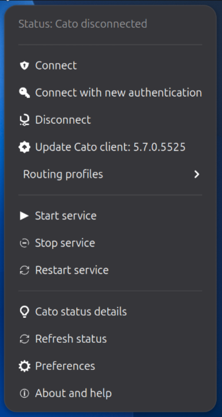
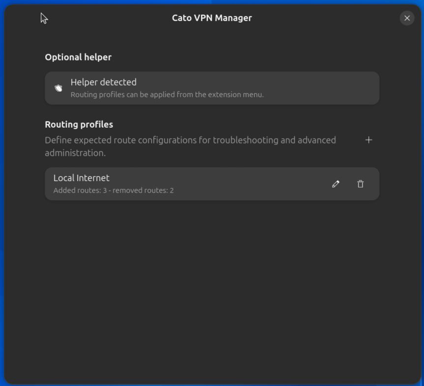

# CATO VPN Manager

A GNOME Shell extension for the Linux Cato SDP client.

CATO VPN Manager puts the everyday Cato actions in the GNOME top bar: connect,
reauthenticate, disconnect, inspect the current client status and keep an eye
on routing behavior without opening a terminal every time.

It is designed for users who rely on Cato VPN on Linux and want a small,
transparent desktop integration rather than a heavyweight control panel.

This project is not affiliated with Cato Networks. Cato and Cato SDP are
trademarks of Cato Networks Ltd.

## Preview





## What It Does

- controls `cato-client.service` from the Shell menu;
- starts, stops and reauthenticates the Cato SDP client;
- reads the authoritative Cato state from `cato-sdp status`;
- shows a readable status details window with copy and refresh actions;
- notifies when the Cato client reports an available update;
- optionally applies routing profiles through a separately installed Polkit
  helper.

## Status Icon

The panel icon is intentionally compact and color based:

- gray: Cato service stopped;
- red: service active, Cato not connected or waiting for authentication;
- green: Cato connected;
- blue: Cato connected and the current Cato routes exactly match a routing profile;
- yellow: Cato connected, but routes are partial, ambiguous or not recognized.

## Routing Profiles

Routing profiles are an advanced feature for debugging, troubleshooting,
technical checks and sysadmin workflows. A profile describes the routes that
should be removed from the Cato interface and the routes that should remain on
it.

Profiles are not applied automatically when the VPN connects. They are selected
from the extension menu and applied only on explicit request, when the optional
helper is installed. Without the helper, the extension can still recognize
whether the current route table matches a configured profile.

## Privacy And System Impact

The extension avoids frequent polling of `cato-sdp status`, because the Cato
daemon may write log output for each status request. Status checks happen at
startup, on explicit refresh and after relevant connection events.

The full Cato status output stays in memory and is not written to disk. It may
contain account names, email addresses and IP addresses, so screenshots should
be anonymized before being published.

## Requirements

- GNOME Shell 50;
- Linux Cato SDP client with `/usr/bin/cato-sdp`;
- systemd service `cato-client.service`;
- iproute2 with `/usr/sbin/ip`.

## Install

Build the extension package:

```sh
make package
```

Install the generated ZIP:

```sh
gnome-extensions install --force dist/catovpn-manager@kaleidoscopeit.github.com.shell-extension.zip
```

Restart GNOME Shell or your GNOME session, then enable the extension:

```sh
gnome-extensions enable catovpn-manager@kaleidoscopeit.github.com
```

## Optional Route Helper

The extension works without privileged components. The optional helper is only
needed to apply routing profiles from the menu.

Helper installation instructions are available in
[`optional-helper/README.md`](optional-helper/README.md).

The helper is not included in the ZIP generated for extensions.gnome.org.

## Development

```sh
make check
make package
```

The generated package excludes privileged helpers, tests, tooling and local
development files.

## License

Distributed under the MIT license. See [`LICENSE`](LICENSE).
